# Odyssey Launcher

**A fully 3D game launcher for your emulators and PC games, inspired by the PlayStation 2's memory card browser.**

Every system and every game is a 3D model: consoles, logo cards, and games in their real boxes, cases and cabinets, wrapped in their own art. Pick a system, pick a game, and it launches in your emulator. Quit the game and you're back where you left off.

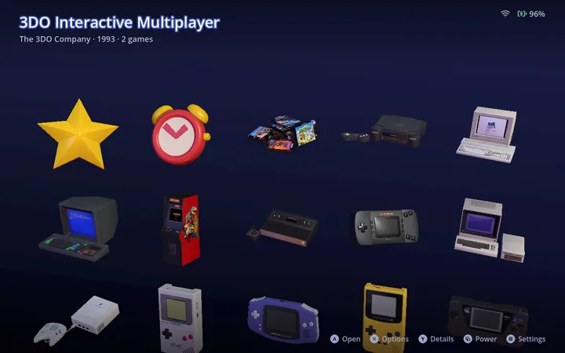

Odyssey Launcher runs on Windows and Linux, and performance is its headline feature.

## Contents

- [Features](#features)
- [Screenshots](#screenshots)
- [Getting started](#getting-started)
- [Controls](#controls)
- [Configuration](#configuration)
- [Themes and models](#themes-and-models)
- [Credits](#credits)
- [Licence](#licence)

## Features

### A 3D library

- Systems and games fly in and out of depth over a gradient or wallpaper as you go from one to the next.
- Games come in their real boxes: Mega Drive clamshells, SNES and N64 boxes, jewel cases, PS2, PSP, DVD and Switch cases, and arcade cabinets, each wrapped in its front, back, spine and label.
- The focused item lifts and sways, and many of the Console theme's machines play a made-up game when focused.
- Bring a game up close and turn it to read the back or the spine.
- Choose from seven layouts: a grid, a grid with names, a carousel, one at a time, a list, a coverflow of spines, and a showcase of the focused game's art and details above a strip of boxes. Set one for everything, or per system.
- Favourites, Recently played and All games sit at the start of the systems grid.

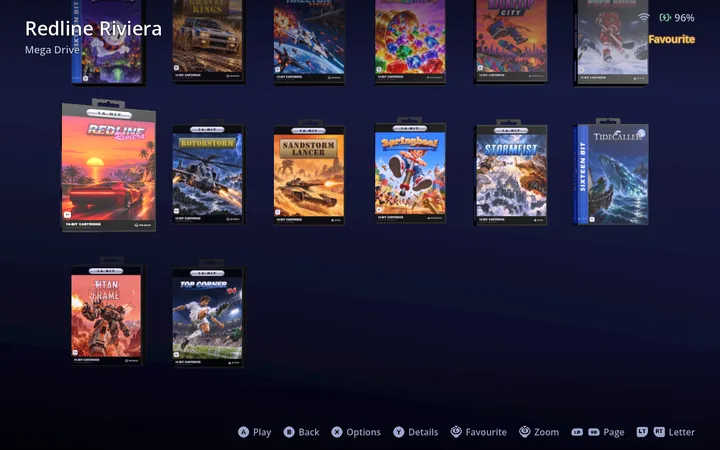

### Your collection

- Multi-disc games, and PS3, PS4 and PS5 game folders, show as one game.
- Titles are cleaned up from No-Intro and Redump names and sorted naturally.
- Sort systems by name, maker or year, and games by title, release date, last played, time played or date added.
- The launcher keeps each game's play count, play time and last played date.
- Import ES-DE, RetroBat and Batocera gamelists without overwriting your own edits.
- Network drives work well, and unplugging one never loses your favourites or history.

### Scraping

- Five providers, in the order you choose: ScreenScraper, LaunchBox's Games DB, IGDB, SteamGridDB and Steam.
- ScreenScraper and LaunchBox work out of the box; add your own accounts for more.
- Scrapes covers, backs, spines, labels, screenshots, logos, fan art, videos and manuals.
- When a match is wrong, choose the right one yourself, alternative art included.
- Your own art and edits always win.

### Details and media

- A game's details show its description, release date, genre, developer, players, rating and play history.
- View images full screen, play videos with sound and read manuals page by page.
- A system's details show its model, ready to turn, beside its history and settings.

### Launching

- Emulator profiles for RetroArch cores, standalone emulators, and games that are their own program or shortcut.
- Give a single game a different emulator when it needs one.
- Steam games count their play time too.
- The launcher steps aside while you play and takes the foreground back when you quit.

### Made for the sofa

- Everything works with a controller, including settings, themes, scraping and updates, with an on-screen keyboard and file pickers.
- The controls along the bottom show Xbox, PlayStation, Switch, GameCube, Steam Deck or Steam Controller buttons, or your keyboard's keys, following whatever you pressed last. You can also fix one kind in the settings.
- Set the UI size small for a desk, or large for a handheld or a television across the room.
- A power menu restarts, shuts down, sleeps or quits.
- Status indicators show the clock, battery and network.
- The keyboard works everywhere too, and the mouse in the menus.

### Performance

The launcher aims to be ready within a second, even with 10,000 games, and to stay locked to your display's refresh rate while you scroll. Covers stream in as you scroll without stutter, and memory use stays low. The baseline is a Steam Deck, handheld at 1280×800 or docked to 4K.

## Screenshots

The games in these screenshots are made up: their names, art and boxes were created for this README.

### Themes

**Slab** (the default) shows each system as a dark slab with its logo. **Console** shows each system as its own console, modelled in 3D, from the Channel F to the PlayStation 5. **Classic View** looks like a 2D launcher: flat logo cards and covers over a wallpaper. Switch themes without a restart, and download more from the settings.

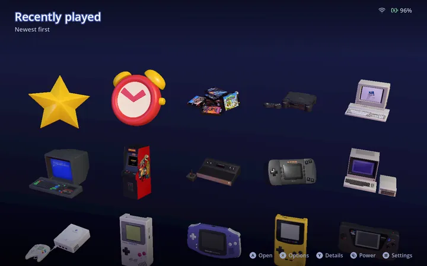

| Console | Slab |
|---|---|
| 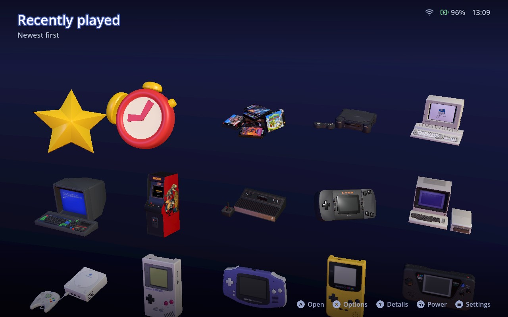 | 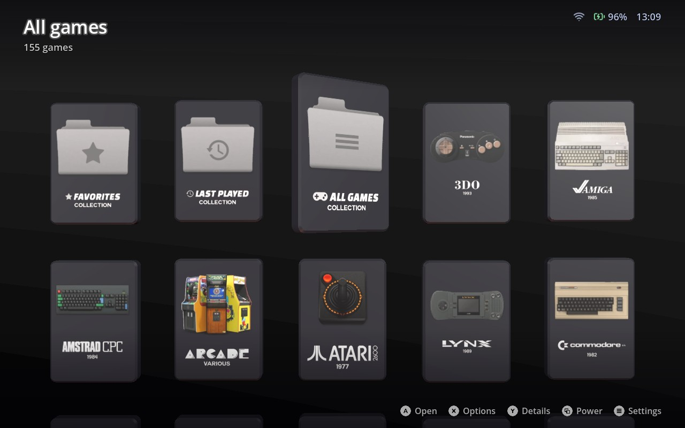 |
| **Classic View** | |
| 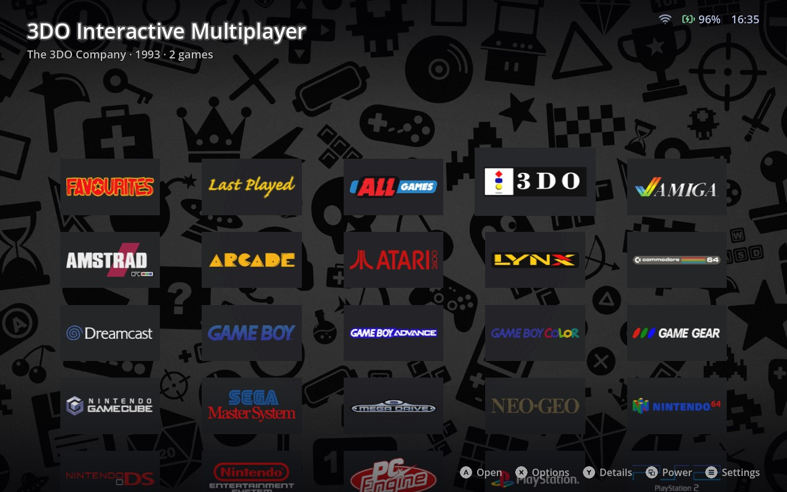 | |

### Games

| Mega Drive | Super Nintendo |
|---|---|
| 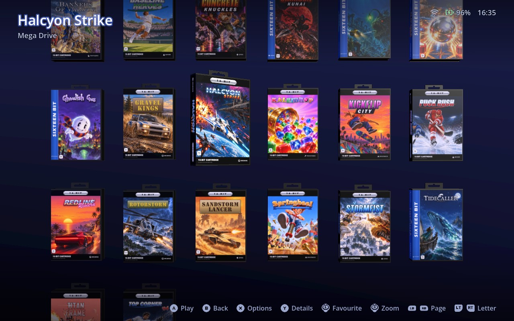 | 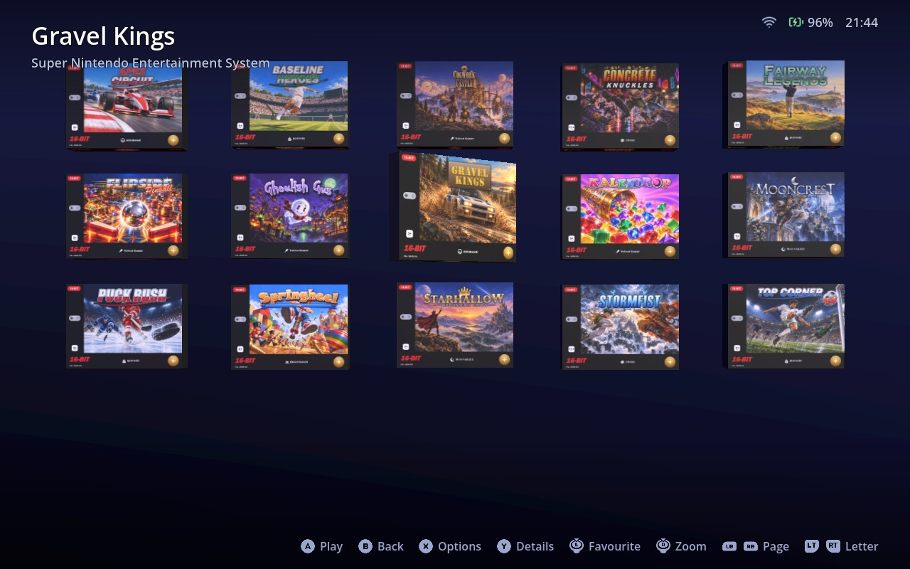 |
| **Arcade** | **Nintendo 64** |
| 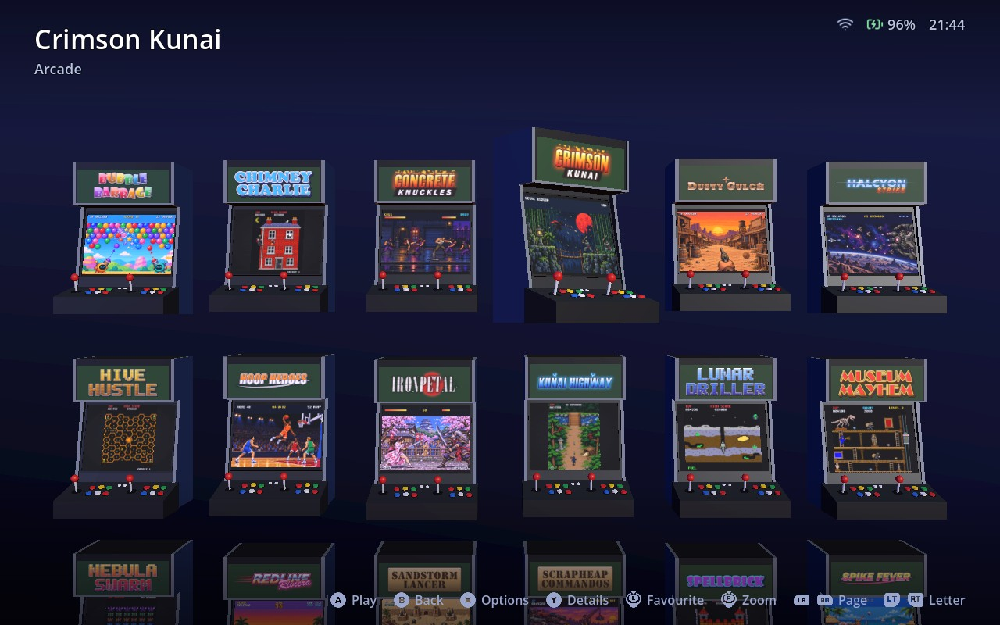 | 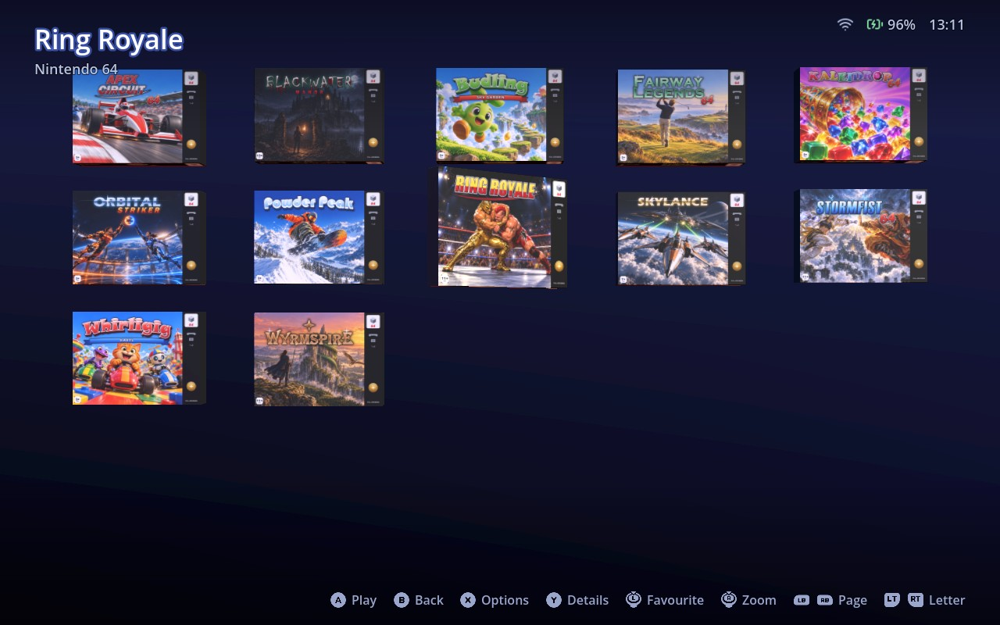 |

### Layouts

| Showcase | Coverflow |
|---|---|
| 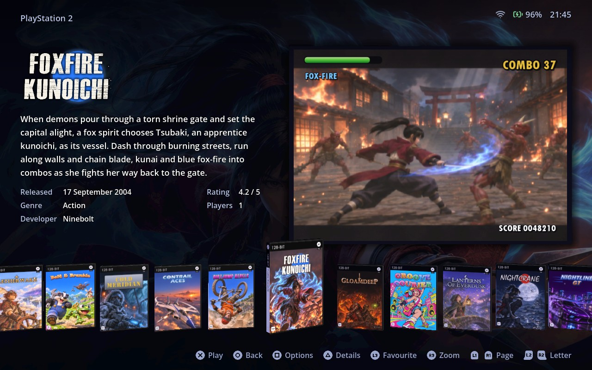 | 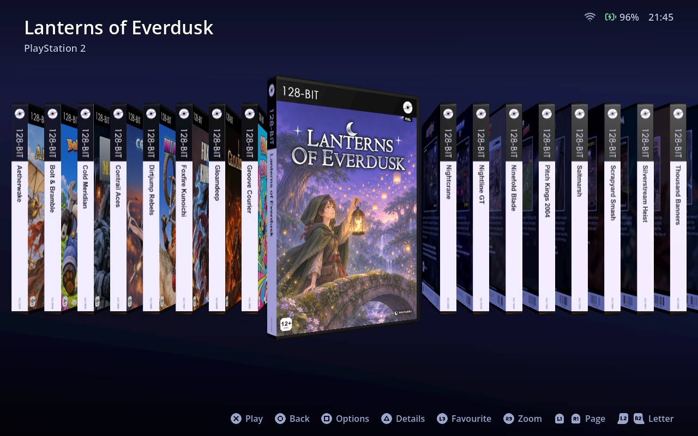 |
| **Carousel** | **List** |
| 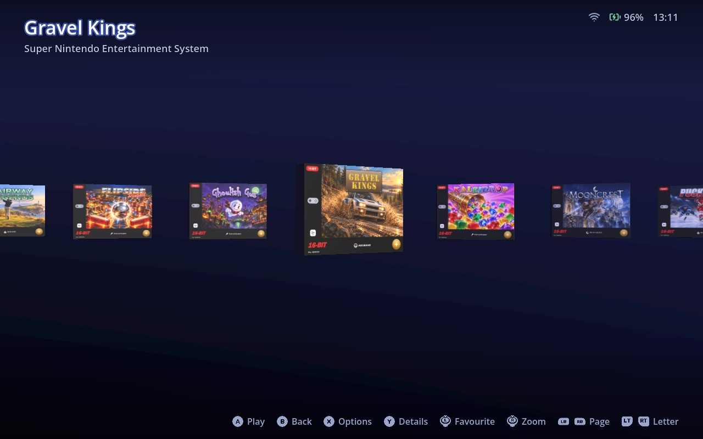 | 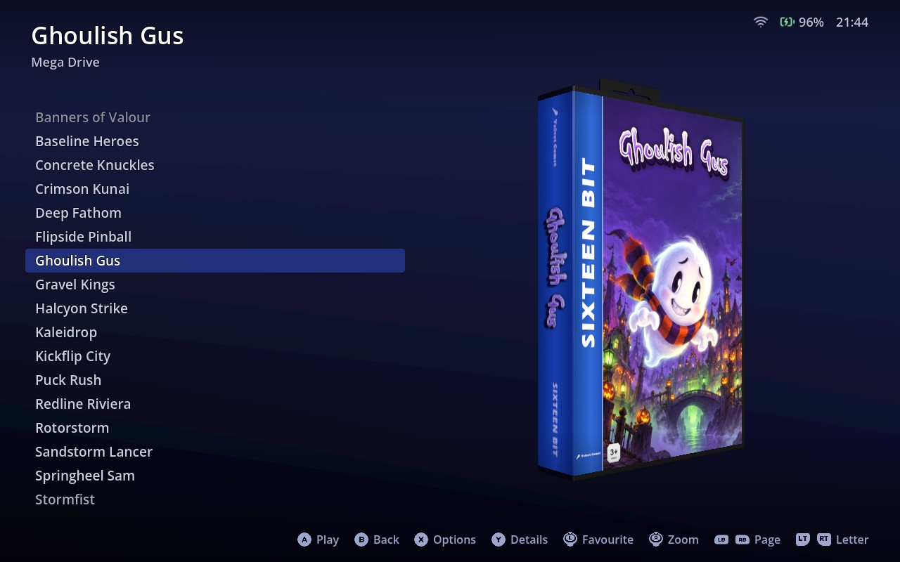 |

### Details, options and settings

| Game details | System details |
|---|---|
| 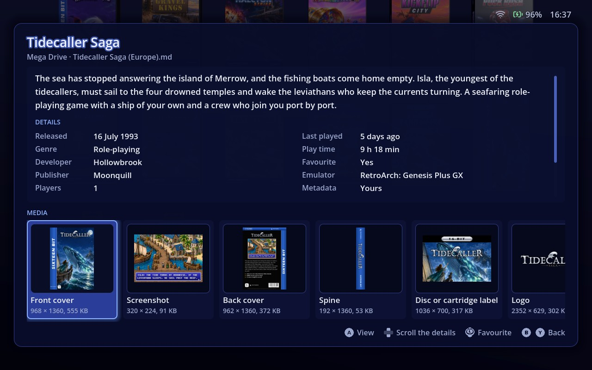 | 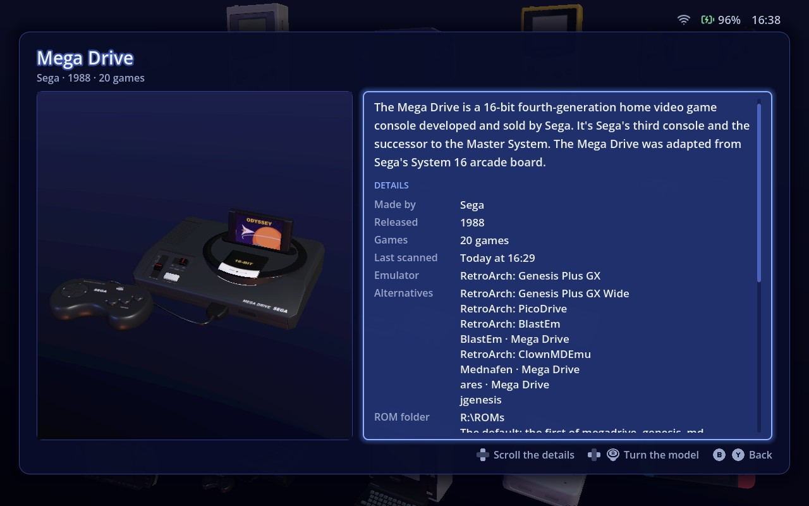 |
| **Game options** | **Settings** |
| 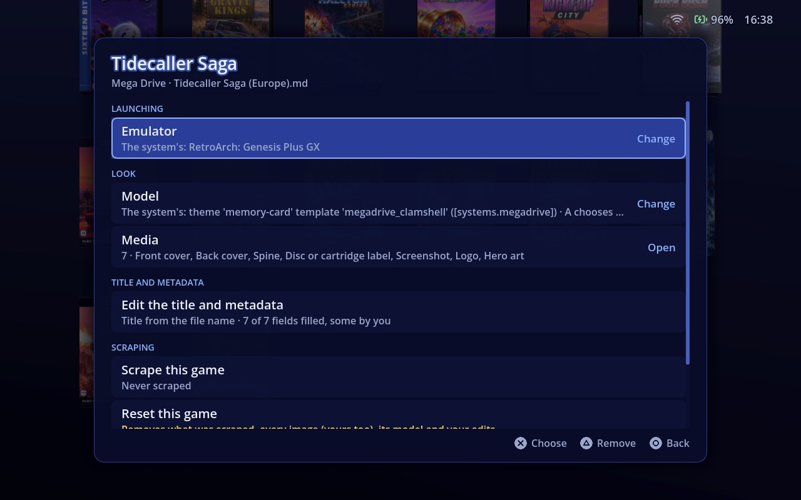 | 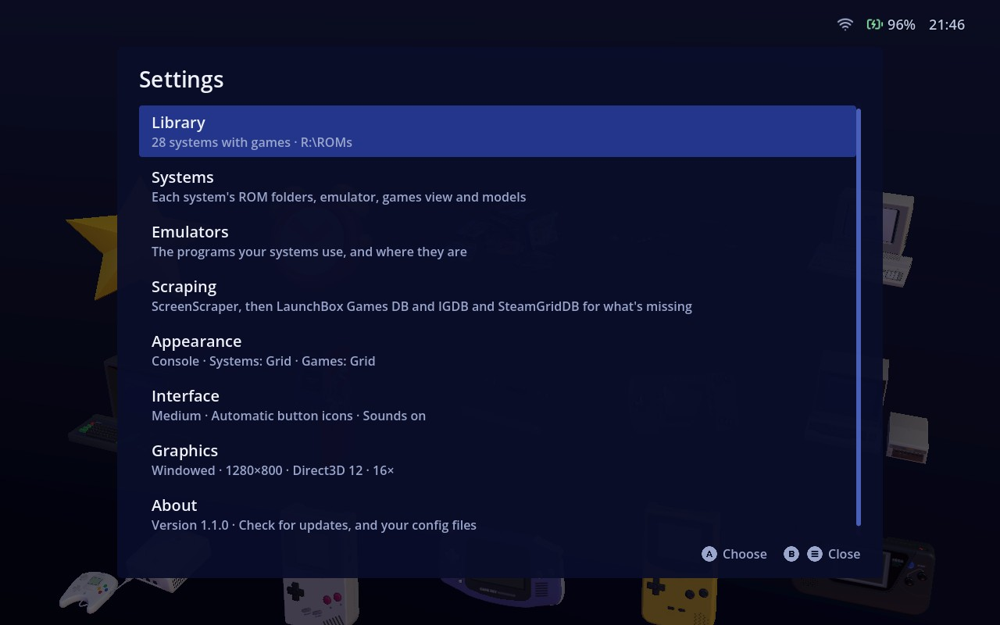 |

## Getting started

1. **Download** the latest release from [Releases](https://github.com/GeekRhapsody/OdysseyLauncher/releases):
   - **Windows:** `OdysseyLauncher-<version>-windows-x86_64.zip`. Unzip it anywhere and run `OdysseyLauncher.exe`. Needs 64-bit Windows 10 or 11 and a GPU with Direct3D 12 or Vulkan.
   - **Linux:** `OdysseyLauncher-<version>-linux-x86_64.AppImage`. Make it executable and run it. Needs a 64-bit distribution with glibc 2.34 or later (Ubuntu 22.04, Fedora 35 or newer), ideally with Vulkan.

   Nothing else to install.
2. **Add your games.** Put each system's games in `ROMs\<system>` in your user folder (`ROMs\megadrive`, `ROMs\snes`...), as in other frontends, or choose other folders in **Settings > Library** and **Settings > Systems**.
3. **Set up your emulators** in **Settings > Emulators**. **Settings > About** lists any that are missing.
4. **Scrape** from **Settings > Scraping** with "Scrape what's missing".

**Portable mode:** put an empty `portable.txt` beside the executable (or the AppImage) and everything is kept in a `userdata` folder next to it.

**Updating:** **Settings > About > Check for updates** installs the newest release and restarts, keeping your settings, library and media.

## Controls

The hints along the bottom of each screen show the buttons for the controller you're using.

| Action | Controller | Keyboard |
|---|---|---|
| Move | D-pad, left stick | Arrow keys |
| Open, play | A | Enter, Space |
| Back | B | Escape, Backspace |
| Options for the focused system or game | X | O |
| Details | Y | I |
| Favourite | L3 | F |
| Inspect (bring the game up close) | R3 | Z |
| Turn the focused item | Right stick | |
| Page up, page down | LB, RB | Page Up, Page Down |
| Previous, next letter | LT, RT | <kbd>[</kbd>, <kbd>]</kbd> |
| Settings (in a system's games, that system's settings) | Menu | F1 |
| Power menu | View | P |
| Next theme, for the session | | T |
| Rescan the library | | F5 |

## Configuration

Everything in the settings is saved to plain TOML files you can also edit by hand: `settings.toml`, `systems.toml`, `emulators.toml` and `secrets.toml` (scraping accounts). They're in `%APPDATA%\OdysseyLauncher` on Windows, `~/.config/OdysseyLauncher` on Linux, or `userdata` in portable mode. Your themes go in a `themes` folder beside them.

## Themes and models

A theme is a folder of 3D models (glTF `.glb`) and images, with a `theme.toml` that sets the background, lighting, menu colours, motion, and each system's model and logo. A theme only states what it changes; everything else comes from the built-in base theme.

You can also give a single system or game its own model from its options, without writing a theme.

To make a theme, see the guide for theme authors, [docs/THEMING.md](docs/THEMING.md), and the sample theme in [samples/themes/retro-tv](samples/themes/retro-tv).

## Credits

### Slab theme logos

The Slab theme's system logos come from [canvas-es-de](https://github.com/Siddy212/canvas-es-de) by [Siddy212](https://github.com/Siddy212), which credits its original artwork and layouts to fagnerpc. They're used under [CC BY-NC-SA 2.0](https://creativecommons.org/licenses/by-nc-sa/2.0/). Changes: cropped, scaled, converted to WebP and some renamed; the PlayStation 5's image was made for Odyssey Launcher in the same layout. The adapted logos are shared under the same licence.

### Classic View theme logos

The Classic View theme's system logos come from [es-theme-carbon](https://github.com/fabricecaruso/es-theme-carbon), Batocera's default theme, by Rookervik (based on simple by Nils Bonenberger), under Creative Commons Attribution-NonCommercial-ShareAlike (its readme names version 2.0 in its heading and 4.0 in its licence text). Changes: rendered from SVG, cropped, scaled, converted to WebP and some renamed. The adapted logos are shared under the same licence.

### Also

- [Godot Engine](https://godotengine.org), which renders everything.
- [ES-DE](https://es-de.org), whose systems catalogue is the basis of the built-in systems.
- [Lucide](https://lucide.dev) for the status icons (ISC) and [Kenney](https://kenney.nl)'s Input Prompts for the button icons (CC0).
- [FFmpeg](https://ffmpeg.org) (LGPL 2.1 or later) and [PDFium](https://pdfium.googlesource.com/pdfium/) (BSD 3-clause and Apache 2.0, built by [pdfium-binaries](https://github.com/bblanchon/pdfium-binaries)) for videos and manuals in the Linux AppImage, unmodified; the AppImage carries their licences and source details.
- [LibGit2Sharp](https://github.com/libgit2/libgit2sharp) (MIT) and [libgit2](https://libgit2.org) (GPLv2 with a linking exception) for downloading themes.
- [ScreenScraper](https://www.screenscraper.fr), [LaunchBox's Games DB](https://gamesdb.launchbox-app.com), [IGDB](https://www.igdb.com), [SteamGridDB](https://www.steamgriddb.com) and Steam for game metadata and art.

## Licence

Odyssey Launcher is released under the [MIT licence](LICENSE), covering its code, tools, documentation, and the models, images, videos and sounds made for it.

What comes from others keeps its own licence: the Slab and Classic View logos (CC BY-NC-SA, see [Credits](#credits)), the Lucide icons (ISC), and the libraries the release ships (Godot, the .NET runtime, LibGit2Sharp and libgit2, and in the Linux AppImage FFmpeg and PDFium). Console makers' names, logos and products are their owners' trademarks.
